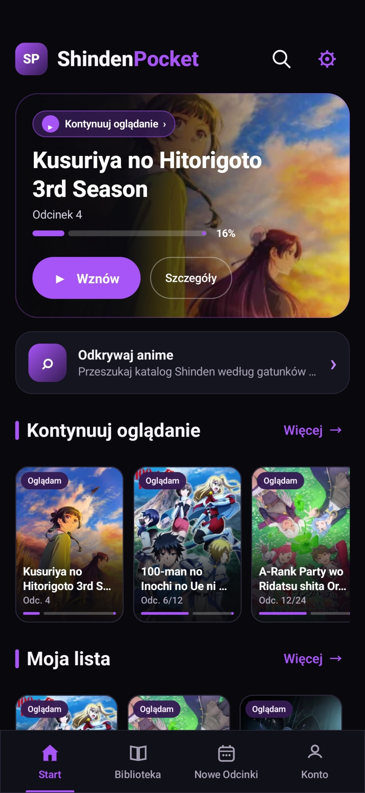
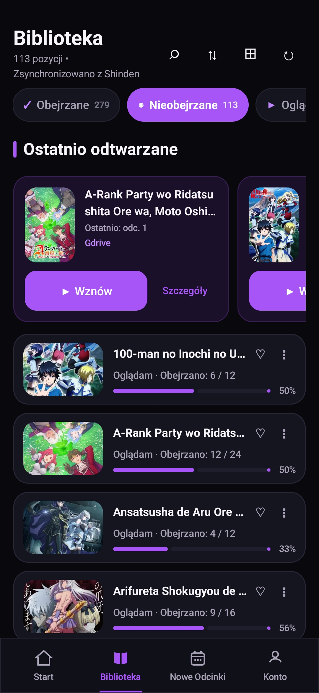
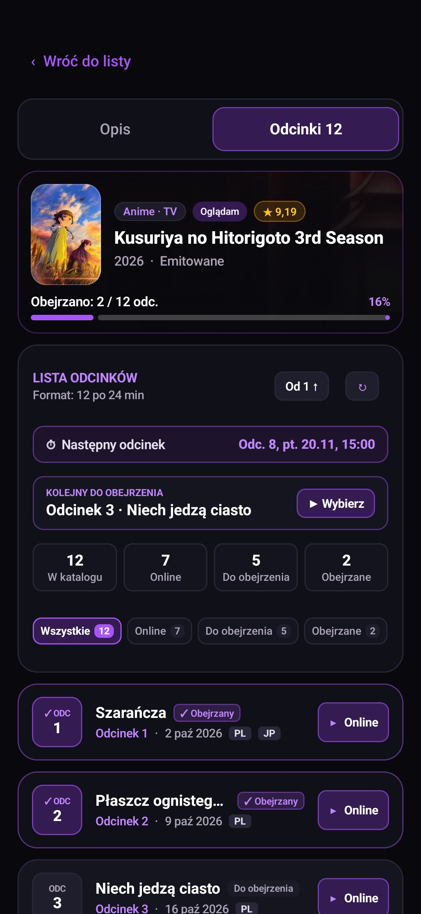
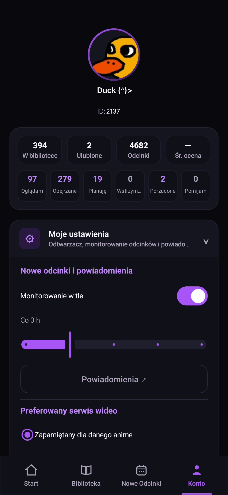

# ShindenPocket

**ShindenPocket** to nieoficjalna aplikacja na Androida do korzystania z Shindena. Początkowo robiłem ją po prostu dla siebie, żeby wygodniej przeglądać anime i oglądać odcinki na telefonie. Projekt jest praktycznie w całości napisany z pomocą AI.

Nie jest to oficjalna aplikacja Shinden.pl. Serwis nie tworzy jej ani nie wspiera.

## Jak wygląda aplikacja?

  
  
  
  

## Co zawiera?

Aplikacja posiada część funkcjonalności strony ( bez wsparcia mang sorki ;' ) pozwalającej komfortowo oglądać anime. Dodatkowo posiada funkcję monitorowania oraz powiadamiania o nowych odcinkach a player w aplikacji jest wyposażony w AdBlocka :)

## Instalacja

Gotowe APK można pobrać z zakładki **[Releases](../../releases)** i zainstalować na telefonie z Androidem.

## Status projektu

Cały czas coś przy niej zmieniam i poprawiam, więc błędy mogą się zdarzać. Niektóre rzeczy mogą też przestać działać, jeśli Shinden zmieni coś po swojej stronie.

## Zastrzeżenia

ShindenPocket nie przechowuje ani nie udostępnia własnych plików wideo - korzysta z odtwarzaczy i linków dostępnych w serwisie. Grafiki, tytuły i pozostałe materiały należą do ich właścicieli.

To prywatny, nieoficjalny projekt, niezwiązany z twórcami Shinden.pl.